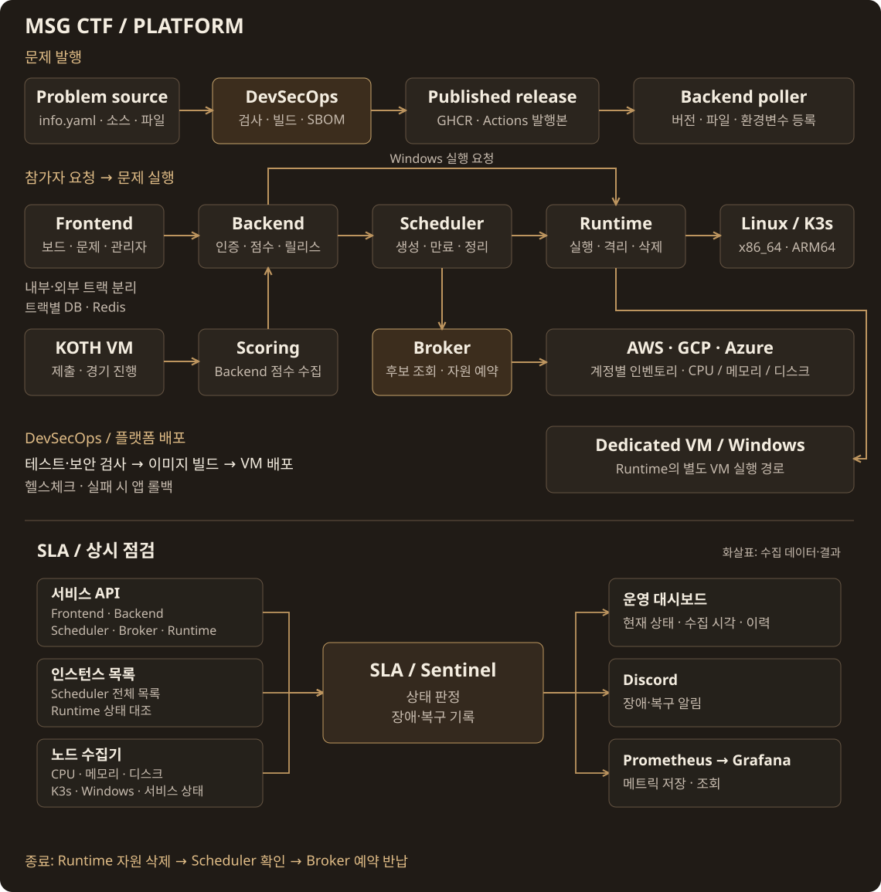

<h1>MSG CTF · DevSecOps</h1>

문제 검사 · 이미지·파일·배포 설정 발행

<a href="https://msg-ctf.github.io/platform.html">플랫폼</a> · <a href="#development">개발 문서</a>

<h2 align="center">Overview</h2>

| 담당 저장소 | 구현 |
| --- | --- |
| [**Challenge pipeline**](https://github.com/MSG-CTF/msgctf-devsecops) | info.yaml 검증 → 이미지 빌드·Trivy·Gitleaks → GHCR·SBOM·발행본 제공 |
| [**Platform pipeline**](https://github.com/MSG-CTF/jm_devsecops/tree/main) | 테스트·보안 검사 → 이미지 빌드 → VM 배포·헬스체크·앱 롤백 |

백엔드가 발행본의 버전·참가자 파일·환경변수를 등록합니다
image-agent·SSH 브리지로 노드에 이미지를 미리 준비합니다

[발행 계약](docs/challenge-registry-integration.md) · [노드 이미지 준비](docs/node-image-prefetch.md) · [플랫폼 흐름 보기](https://msg-ctf.github.io/platform.html#architecture)

<h2 align="center">Contributors</h2>

<table align="center">
<tr><th align="center" colspan="4"><a href="https://github.com/MSG-CTF/msgctf-devsecops">DevSecOps</a></th><th align="center" colspan="4"><a href="https://github.com/MSG-CTF/secure-provisioner/tree/dev">Runtime</a></th><th align="center" colspan="4"><a href="https://github.com/MSG-CTF">PM</a></th></tr>
<tr>
<td align="center" valign="top" colspan="4" width="260"> <a href="https://github.com/wlsdnd2367"><b>wlsdnd2367</b></a> 문제 CI · 검사·발행 노드 이미지 준비</td>
<td align="center" valign="top" colspan="4" width="260"> <a href="https://github.com/goldsimchoi"><b>goldsimchoi</b></a> GCP 런타임 HTTPS 배포 시험</td>
<td align="center" valign="top" colspan="4" width="260"> <a href="https://github.com/jongcoding"><b>jongcoding</b></a> 환경변수·비밀값 참조 Crypto·Rev 실행 연결</td>
</tr>
</table>

기여 기록 · 관련 PR

| 기여자 | 기여 내용 | 관련 PR |
| --- | --- | --- |
| [wlsdnd2367](https://github.com/wlsdnd2367) | 공통 문제 CI, 명세·보안 검사·SBOM·발행 bundle과 노드 이미지 준비 연결 | [#17](https://github.com/MSG-CTF/msgctf-devsecops/pull/17) · [#26](https://github.com/MSG-CTF/msgctf-devsecops/pull/26) · [#34](https://github.com/MSG-CTF/msgctf-devsecops/pull/34) |
| [jongcoding](https://github.com/jongcoding) | 실행 환경변수·비밀값 참조와 Crypto·Rev TCP 프로필 연동 | [#19](https://github.com/MSG-CTF/msgctf-devsecops/pull/19) · [#22](https://github.com/MSG-CTF/msgctf-devsecops/pull/22) |
| [goldsimchoi](https://github.com/goldsimchoi) | GCP 런타임 HTTPS 배포 시험 경로 | [#16](https://github.com/MSG-CTF/msgctf-devsecops/pull/16) |

<h2 align="center">Tech Stack</h2>

 &nbsp;  &nbsp;  GitHub Actions · Docker · Trivy Python · Buildx · GHCR · Gitleaks · SBOM

## Development

- [참가자 제공 파일 계약](docs/participant-files-contract.md)
- [문제 저장소 호출 예제](docs/challenge-caller-example.yml)
- [GCP 런타임 시험](docs/gcp-runtime-https-smoke.md)
- [기존 Pod image-agent 연결](docs/vm-pod-image-agent.md)
- [설치·실행 안내](README.reference.md)

<a href="https://github.com/MSG-CTF/msg-ctf.github.io/blob/67e93a09ce630910f98ae56fb118ca1317af78e0/docs/tech-icons.md">아이콘 출처</a>

